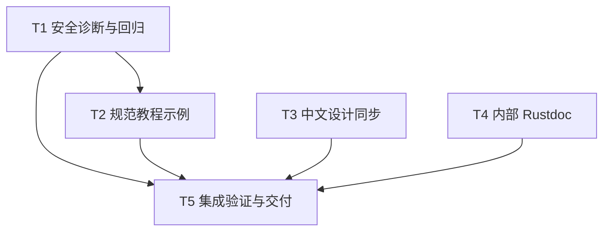

# rs-config 诊断与文档完善实施计划

> **面向智能体执行者：** 使用 writing-plans 对应的 executing-plans 流程逐项实施；步骤使用复选框跟踪。当前文件是计划，不代表已完成实现或验证。

**目标：** 完成 CFG-001 至 CFG-004，以最小改动改善错误诊断、示例持续验证和关键文档。

**架构：** 保留现有公共 API、Serde 错误脱敏边界和文档检查机制；仅新增私有错误构造函数、三组规范示例和必要说明。

**技术栈：** Rust 1.94 / edition 2024、Serde、Cargo、Python unittest、Markdown。

**项目根目录：** `/data/working/qubit/rust-common/rs-config`。

**设计依据：** [配套设计](design-20261031T070010927Z-96e540ba.md)。

**执行位置：** 当前 Paseo workspace；本计划不要求创建或打开新 Paseo workspace。两份交付文档直接保存在项目 doc 目录，不使用临时文档工作区。

## 采纳范围与持续约束

| 条目 | 范围 | 实施任务 |
| --- | --- | --- |
| CFG-001 / P2 | 安全的内部结构和元组长度诊断及回归测试 | T1 |
| CFG-002 / P3 | 三组教程规范示例、双语同步和持续运行 | T2 |
| CFG-003 / P3 | 中文设计补齐插值作用域 | T3 |
| CFG-004 / P3 | 来源索引与序列访问关键 Rustdoc | T4 |

明确搁置或拒绝：无。用户本次未限定采纳范围，按命令默认纳入全部四项。

- 只修改与上述条目直接相关的内容，不顺手重构、格式化或清理。
- 不为统一风格或潜在扩展扩大重构范围；不引入公共错误类型或新的文档执行框架。
- CI 只验证当前 crate，不加入或保留下游 all-features 测试；本轮不修改下游仓库。
- 在当前 Paseo workspace 工作，不创建或打开新的 Paseo workspace。
- 保留既有工作树修改；方案生成时三个修改文件为 `src/config.rs`、`src/config/internal/config_wire_seed.rs`、`tests/config/config_wire_tests.rs`，均不在预期写入集合内。

当前仅生成方案的阶段边界在文档交付后结束。未来执行本计划时应完成代码、测试和文档工作；Git 提交、推送等操作依后续实施命令的明确授权及仓库规则判断，本计划不增加默认提交步骤。

## 调度图

路径均相对于项目根目录。任务按 T1→T2→T3→T4→T5 顺序由当前执行者实施，减少诊断措辞和指南说明之间的返工。T3/T4 在技术上可独立进行，写入集合互不重叠，属于同一可并行批次；本计划不要求启动额外智能体。

| 任务 | 前置任务 | 最小解锁产物 | 写入集合 | 本地验证 | 集成验证归属 | 审查时机 |
| --- | --- | --- | --- | --- | --- | --- |
| T1 | 无 | 设计中三种私有诊断构造及公共行为测试 | `src/error/config_deserialize_error.rs`、`src/conversion/structured_read/source_deserializer.rs`、`tests/conversion/config_value_deserializer_tests.rs`、`tests/error/config_deserialize_error_tests.rs` | 两个相关 Cargo test target | T5 | 立即审查 |
| T2 | T1 | 已确定的诊断与脱敏边界说明 | 三个新 examples、`scripts/check-doc-examples.py`、`scripts/check_doc_examples_tests.py`、`.infra/project-ci-check.local.sh`、两种 `doc/user_guide` | Python 检查及三例默认运行 | T5 | 立即审查 |
| T3 | 无；与 T4 同一独立批次 | 已有英文段落及中文指南 | `doc/design.zh_CN.md` | 文本和链接核对 | T5 | 批量审查 |
| T4 | 无；与 T3 同一独立批次 | 已有结构化读取不变量 | `src/conversion/structured_read/source_index.rs`、`source_seq_access.rs`、`scalar_seq_access.rs` | 注释与调用链人工核对 | T5 | 批量审查 |
| T5 | T1、T2、T3、T4 | 四项变更均完成 | 必要的范围内修正；验证记录 | 本 crate 集成命令 | T5 | 立即审查 |



各 Cargo 重型验证共享项目 target/cache，统一归 T5 串行执行；focused 验证不重复完整矩阵。任务间解锁依赖内容可用，不以提交 Git 作为强制前提。

## T1：安全诊断与回归（CFG-001）

- [ ] 查看当前 `git status --short` 和相关 diff，记录最新已有改动。读取项目指令及适用的 `~/.agents/specs/rust-coding.mdc`、`rust-comment.mdc`、`rust-test.mdc`；本项是已确认诊断改进，按实际修改性质判断 bug-fix 规则是否触发。
- [ ] 在现有公共集成测试 target 中先增加诊断回归。使用公共 API 构造输入，不新增 private test hook。原生集合的核心测试应等价于：

```rust
let mut config = Config::new();
config.set("app.pair", vec![1_i32, 2, 3])?;
let error = config.deserialize::<(i32, i32)>("app.pair").unwrap_err();
assert_eq!(error.kind(), qubit_config::ConfigErrorKind::Deserialize);
assert_eq!(error.path(), Some("app.pair"));
assert!(error.to_string().contains("length 3"));
assert!(error.to_string().contains("expected 2"));
```

  测试函数返回 `ConfigResult<()>` 并以 `Ok(())` 结束。补齐长度 0、1、2、3 的用例；长度 2 成功，其余准确报告已知长度。通过现有 `RequiredPair` 等目标类型覆盖嵌套和 section 根相对路径。
- [ ] 添加标量拆分 `"1,2,3"`→二元组用例，策略使用 `ReadPolicy::env_friendly()`；断言“more elements”和“expected length 2”，不要求完整实际长度。保留并复用现有尾部转换、空项和预算优先级测试。
- [ ] 增加 map/sequence 形状错误断言，并保留 `tests/error/config_deserialize_error_tests.rs` 的 custom/恶意 Expected canary 测试。对输入 canary，检查 Display 和 Debug 均不泄露；不要把自定义 Expected 描述加入白名单。
- [ ] 运行以下 focused target，确认新增诊断断言因旧摘要失败，而不是因测试编译错误失败：

```sh
cargo test --locked --test config_value_deserializer_tests
cargo test --locked --test config_deserialize_error_tests
```

- [ ] 在 `ConfigDeserializeError` 内实现设计规定的三种私有构造，返回现有 `Message`，附带 `Some(path.to_owned())`。实现核心应分别等价于：

```rust
Self::Message {
    message: format!("configuration value must have shape: {expected}"),
    path: Some(path.to_owned()),
}
Self::Message {
    message: format!("configuration tuple has length {actual}; expected {expected}"),
    path: Some(path.to_owned()),
}
Self::Message {
    message: format!("configuration tuple has more elements than expected length {expected}"),
    path: Some(path.to_owned()),
}
```

  签名依次为 `shape_mismatch(path: &str, expected: &'static str) -> Self`、`tuple_length(path: &str, actual: usize, expected: usize) -> Self`、`tuple_has_extra_items(path: &str, expected: usize) -> Self`，可见性 `pub(crate)`。添加英文 Rustdoc；保留 `de::Error` 实现对外部文本的过滤。
- [ ] `type_error` 的函数体改为 `ConfigDeserializeError::shape_mismatch(path, expected)`。原生集合长度检查改为：

```rust
if let Some(expected) = expected_len
    && expected != values.len()
{
    return Err(ConfigDeserializeError::tuple_length(&self.path, values.len(), expected));
}
```

  标量 visitor 成功后的检查改为：

```rust
if let Some(expected) = expected_len
    && access.has_remaining()?
{
    return Err(ConfigDeserializeError::tuple_has_extra_items(&self.path, expected));
}
```

  保留此前的 visitor 失败传播，不扫描尾部，不修改 `ScalarSeqAccess` 行为。
- [ ] 重跑两个 focused target；检查 path、kind、安全摘要、成功输入和失败优先级。发现旧断言依赖完整摘要时，仅更新此次有意改变的库内消息，不能削弱 canary 安全断言。

## T2：扩展规范示例（CFG-002，并同步 CFG-001 文案）

**新建文件：** `examples/config_custom_target.rs`、`examples/config_read_policy.rs`、`examples/config_structured_guide.rs`。

**修改文件：** `scripts/check-doc-examples.py`、`scripts/check_doc_examples_tests.py`、`.infra/project-ci-check.local.sh`、`doc/user_guide.md`、`doc/user_guide.zh_CN.md`。

- [ ] 在读取策略、基础结构化读取、自定义目标类型三个现有完整教程处定位英文/中文对应代码块。以现有代码为起点，提取为上述规范文件，使用现有 `COPYRIGHT_HEADER`、公共 API 和默认 feature；按 Rust import 规则组织两个文档的相同代码。
- [ ] 自定义目标类型示例保留原教程全部普通读取、插值、失败类别和路径断言。策略示例增加 `assert_eq!(config.default_read_policy(), &ReadPolicy::default());`，证明临时 view 不修改根策略。结构化示例同时断言 `server.host == "localhost"` 与 `server.port == 8080`。
- [ ] 在 Python 测试中先要求新增三个 ID，扩展现有临时目录夹具测试：每个 ID 分别缺中文标记、改变中文代码、缺规范文件时必须失败；无破坏夹具时通过。允许参数化现有测试，避免重复实现解析器。
- [ ] 运行 `python3 -B scripts/check_doc_examples_tests.py`，确认所增加断言在旧配置下失败。
- [ ] 在 `EXAMPLE_DOCS` 添加以下三项，并在两种指南的对应代码块前添加同名标记：

```python
"config_custom_target": ("doc/user_guide.md", "doc/user_guide.zh_CN.md"),
"config_read_policy": ("doc/user_guide.md", "doc/user_guide.zh_CN.md"),
"config_structured_guide": ("doc/user_guide.md", "doc/user_guide.zh_CN.md"),
```

  标记形式为 `<!-- example: config_custom_target -->`，其后立即是 Rust fence；另外两项对应替换 ID。代码正文须等于规范文件去掉现有文件头后的完整文本。
- [ ] 修改 shell hook 前读取 `~/.agents/specs/shell.mdc`。在现有示例命令旁增加：

```sh
cargo run --locked --example config_custom_target
cargo run --locked --example config_read_policy
cargo run --locked --example config_structured_guide
```

  不改变现有测试 fixture、矩阵或引入下游命令。
- [ ] 同步两种指南的诊断说明：外部 Serde Expected/Unexpected/custom 仍被过滤；库内部固定结构名称、已知完整长度或多余项信息可以报告。不承诺完整错误字符串稳定。
- [ ] 运行 Python 检查器和测试，并运行上述三条默认 feature 示例；预期检查器报告 12 组，所有示例断言通过。剩余上下文片段不纳入全量编译承诺，不重写 README。

## T3：中文设计补齐（CFG-003）

**修改文件：** `doc/design.zh_CN.md`。

- [ ] 对照英文设计 Structured Serde 章节、中文指南对应章节以及 `ConfigSerdeExt::deserialize_with` 的现有文档，确认描述的两种输入形态。
- [ ] 在对象成员名说明后新增中文段落，包含四个事实：点分后代从选中子树查找；精确结构化属性从调用 reader 查找；对象成员不自动成为 Config key；根配置和显式环境回退维持现有规则。
- [ ] 添加 `[结构化读取说明](user_guide.zh_CN.md#反序列化结构化值)` 链接，核对目标标题存在。人工复核中英文语义；不改实现、不为文字变更新增行为测试。

## T4：关键内部 Rustdoc（CFG-004）

**修改文件：** `src/conversion/structured_read/source_index.rs`、`src/conversion/structured_read/source_seq_access.rs`、`src/conversion/structured_read/scalar_seq_access.rs`。

- [ ] 读取 Rust 文档规则，并沿 `PreparedConfigRead::push`、`insert_property`、`SourceDeserializer::sequence` 和各 SeqAccess 调用确认真实不变量，不把可能暂时未完成的构造状态写成永久保证。
- [ ] 给 `SourceIndex::is_exact`、`push_origin`、`push_property` 添加英文 Rustdoc。追加操作注明 Tree-only、Exact 调用的 panic，以及 arena node ID 与 source property index 的区别和构造顺序。
- [ ] 给 `SourceSeqAccess` 的 `context`、`values`、`session` 字段与 `new` 补充借用、共享会话、外层 source_index 保留语义。不要声称创建访问器就已转换所有元素。
- [ ] 给 `ScalarSeqAccess` 添加类型级说明，并明确 `has_remaining` 具有消费/收费及失败传播行为。保留实现，避免为文档扩大可见性或调整 inline/must_use。
- [ ] 人工核对新增注释与调用点一致，检查本任务 diff 只有 Rustdoc。全量 Rustdoc 构建由 T5 统一负责。

## T5：集成验证与交付

- [ ] 核对 T1—T4 的验收内容及写入集合；与当前已有 diff 区分，保留用户未提交修改。若出现文件并发变化，先读取新内容再整合，不覆盖。
- [ ] 先执行轻量文档检查：

```sh
python3 -B scripts/check_doc_examples_tests.py
python3 -B scripts/check-doc-examples.py
```

  预期全部测试通过，报告 12 组规范示例。
- [ ] 串行执行当前 crate 的回归与文档检查：

```sh
cargo test --locked
cargo test --locked --all-features
cargo doc --locked --no-deps --document-private-items
cargo doc --locked --all-features --no-deps --document-private-items
```

  预期默认/full 测试通过；新增 Rustdoc 无无效链接或文档警告。`cargo test` 包含的 doctest 不等于 Markdown 示例执行。
- [ ] 将 T2 三条 `cargo run --locked --example ...` 各追加一次 `--features full` 执行，证明新增示例在两种 feature 组合下均通过。默认运行结果复用 T2；只有内容变化才重跑。
- [ ] 依据当前项目规则运行所需格式、风格和 CI 门禁，先检查入口及作用范围。已有 `.infra/bin/ci-check.sh` 会再次执行项目 hook，其重复 focused 检查是入口自带行为，不额外创建测试矩阵；不运行下游 all-features。若格式命令会改动无关文件，采用限定文件的等效命令并记录依据，避免无关改动。
- [ ] 如共享基础设施要求 Clippy、coverage 或其他门禁，由本任务统一执行并记录实际命令、结果及工具限制；本次不因历史覆盖率数字推断通过，也不机械调整覆盖率豁免。
- [ ] 复核 `doc/design.zh_CN.md` 相对链接和锚点、两种指南代码与规范文件一致、消息说明与实现一致。无需新增仅断言文字的测试。
- [ ] 输出每项 CFG 编号对应完成情况、实际验证结果和未解决限制。失败用例必须解释和解决或如实标记，不能仅以构建成功代替回归通过。提交及远端操作遵循后续实施命令，不由本计划推断授权。

## 设计要求到验收的映射

| 要求 | 任务 | 完成依据 |
| --- | --- | --- |
| 库内安全结构摘要、已知长度、标量下界 | T1 | 公共测试覆盖且类别/路径保留 |
| 外部消息脱敏、短路和预算优先级不变 | T1、T5 | canary、现有惰性行为回归通过 |
| 三组完整教程持续验证 | T2、T5 | 12 组一致性检查、三例默认/full 运行 |
| 中文插值作用域语义完整 | T3、T5 | 对照英文、Rustdoc、指南和链接 |
| 索引及序列内部合同文档化 | T4、T5 | 人工核对及私有项 Rustdoc 构建 |
| 范围、已有工作树和 crate-only CI | 全部、T5 | 最终 diff、命令记录，无下游扩展 |

本轮不需要调用方迁移或依赖升级。若应用依赖完整错误摘要，仅调整对应断言；程序分支仍依据错误类别与上下文访问器。
